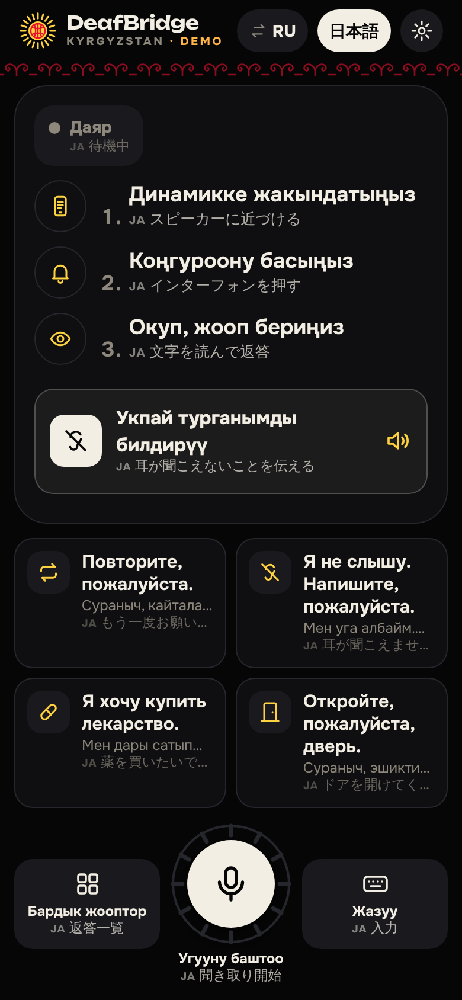
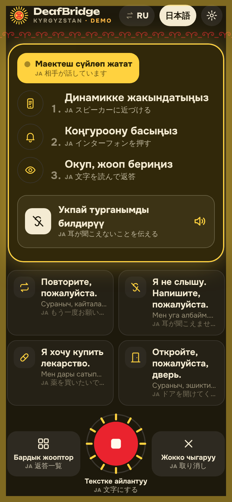
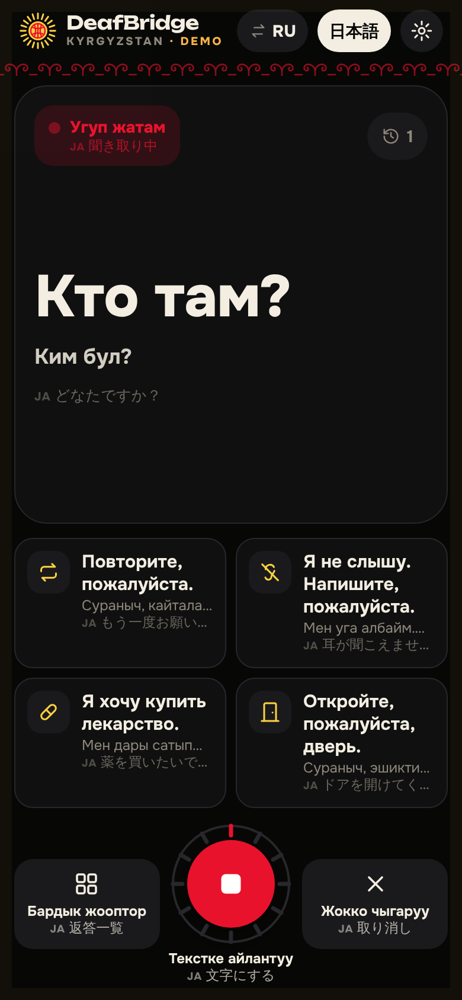
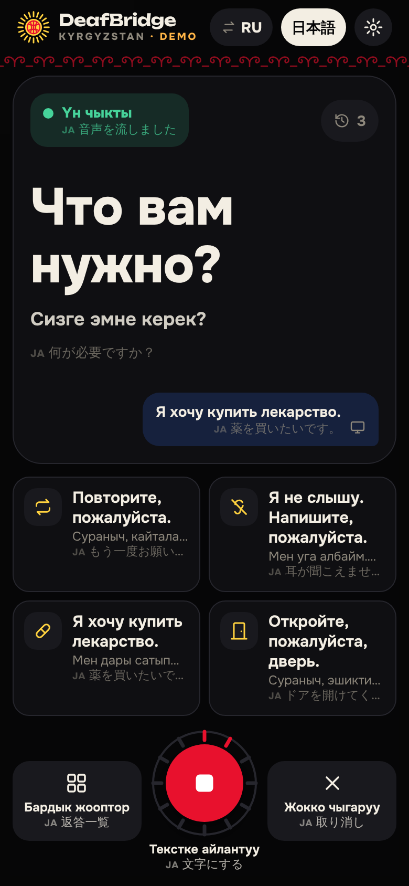
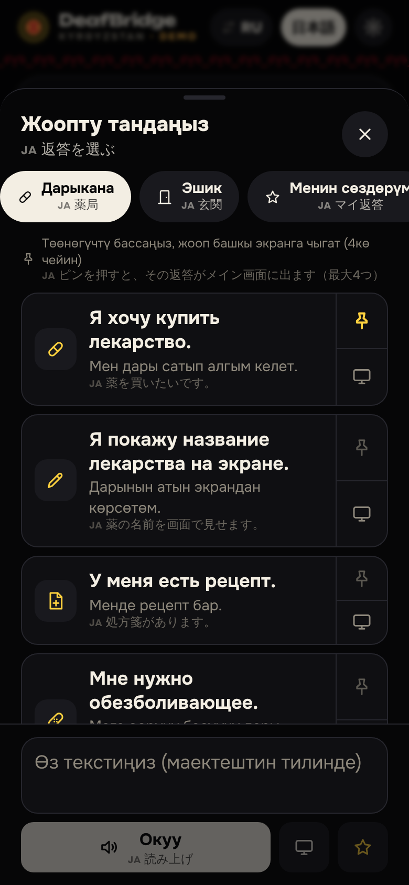
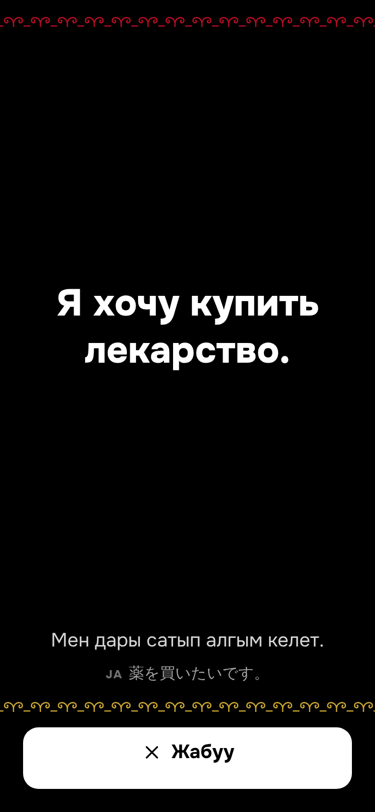
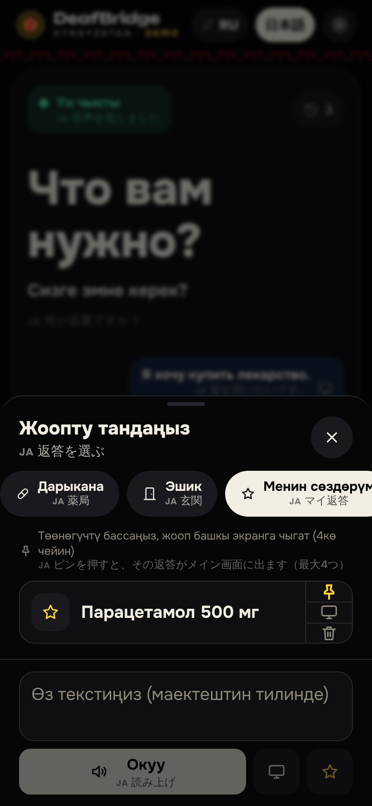
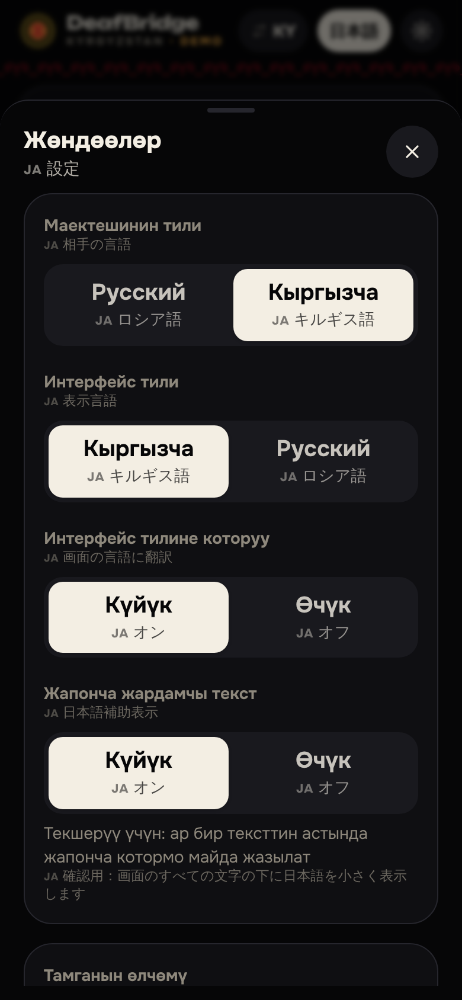
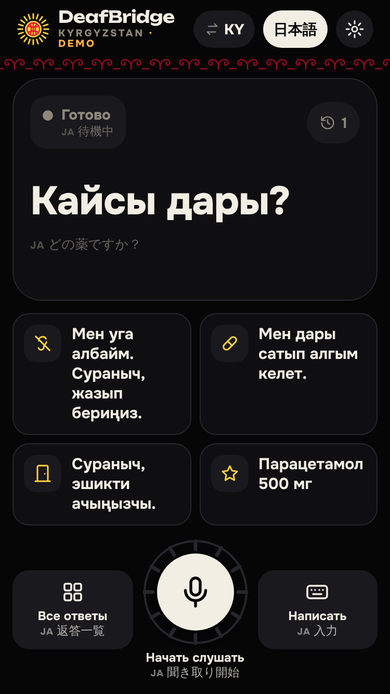

# DeafBridge KG — キルギスのろう者のためのインターフォン会話支援アプリ（MVP）

**キルギスのろう者・難聴者**が、夜間薬局などのインターフォン越しに会話するための iPhone 向け Web アプリ（PWA）です。

- 相手の声（**ロシア語・キルギス語**）をスマホのマイクで拾い、**大きな文字**で表示します
- 画面は**キルギス語**（既定）または**ロシア語**。相手がロシア語で話しても、キルギス語訳を下に表示できます
- 利用者は**ボタンをタップするだけ**で、定型文を相手の言語の**音声で返答**できます（絵文字付きで文字が苦手でも選びやすい）
- 音が聞こえない人のために、**「相手が話しています」表示・画面フラッシュ・振動・再生完了の表示**で状況を目で分かるようにしています
- 音声が出せない場合は「**画面を見せる**」で、返答を全画面の大きな文字で相手に見せられます

### 🇯🇵 日本語補助（確認用）

開発・確認のため、**画面のすべての文字の下に日本語を小さく表示**する「日本語補助」機能があります（現在は既定でオン）。
画面右上の「**日本語**」ボタン、または設定画面でいつでもオン／オフできます。
相手の言葉にも日本語訳が付くので、キルギス語・ロシア語が読めなくても動作と内容を確認できます。
当事者に渡すときはオフにしてください。

> ⚠️ これは試作版（MVP）です。医療・緊急時の唯一の連絡手段として使わないでください。

**1画面で完結**するデザインです（スクロール不要）。上に相手の言葉を大きく表示する「ステージ」、下に返答ボタンと録音ボタン。返答一覧・設定・履歴は下から出るパネルで開きます。

**黒を基調に、キルギスのモチーフ**を取り入れています。
- ロゴとアプリアイコン：キルギス国旗の**太陽とトゥンドゥク**（ユルトの天窓）
- ヘッダーと「画面を見せる」の帯：シルダク（フェルト絨毯）の**кочкор мүйүз（羊の角）文様**
- 色に意味を持たせる：国旗の**太陽の黄＝相手が話している**、**国旗の赤＝録音中**、フェルトの藍＝自分の返答、生成り＝文字
- 録音ボタンのリングはトゥンドゥクをかたどり、音量に合わせて光ります
- アイコンは絵文字をやめ、線の太さをそろえた自前のアイコンセット（`src/components/icons.tsx`）

| 待機 | 相手が話している | 文字化（ロシア語→キルギス語＋日本語） | 返答後 |
|---|---|---|---|
|  |  |  |  |

| 返答一覧（ピン留め） | 画面を見せる | マイ返答 | 設定 | iPhone SE |
|---|---|---|---|---|
|  |  |  |  |  |

（スクリーンショットは API 未接続の**デモモード**で撮影。表示文はサンプルです）

---

## 1. 利用者の操作の流れ

1. アプリを開き、下の丸い**録音ボタン**「**Угууну баштоо**（聞き取り開始）」をタップ
2. スマホをインターフォンのスピーカーに近づけてから、**インターフォンを押す**
3. 必要なら「**Укпай турганымды билдирүү**（耳が聞こえないことを伝える）」をタップ → 「耳が不自由です。スマホが声を文字にします。ゆっくり話してください」とロシア語/キルギス語で流れる
4. 相手が話し始めると、**画面が光り**、黄色い「**Маектеш сүйлөп жатат**（相手が話しています）」が出る
5. 相手が話し終わると**自動で文字化**され、黄色いカードに大きく表示（ロシア語なら下にキルギス語訳）
6. 返答ボタンをタップ → **相手の言語で音声が流れる**。画面上部に「再生中」→「音声を流しました」と表示
7. 再生が終わると自動で聞き取りに戻る

**「録音開始 → インターフォンを押す」の順番**にすることで、相手の最初の言葉を取り逃がしません。
アプリは待ち受け中ずっと録音しており、**声を検出した部分だけ**を文字化サービスに送ります
（無音は送らないので費用もかかりません）。

### ろう者向けの配慮

| 課題 | 対応 |
|---|---|
| 相手が話し始めたことに気づけない | 「相手が話しています」バナー＋画面フラッシュ＋振動（Android） |
| 音を拾えているか分からない | 音量バー（声を検出すると緑） |
| 返答音声が本当に鳴ったか分からない | 「再生中」「音声を流しました」の表示 |
| iPhone をマナーモードにしていることが多い | iOS の Audio Session API で消音スイッチ中も再生を試みる＋「マナーモードを解除」の案内 |
| 文字だけだと選びにくい | 返答ボタンにアイコン |
| 薬の名前など毎回入力するのが大変 | 「**マイ返答**（Менин сөздөрүм）」に保存（端末内のみ） |
| 音声が出せない・相手が聞き取れない | 「画面を見せる」で全画面表示（直前の自分の返答をタップしても表示） |
| よく使う返答がいつも違う | 返答一覧でピン📌を押すと、メイン画面の4つを入れ替えられる |

## 2. 機能一覧（設計書との対応）

| 優先度 | 機能 | 状態 | 実装メモ |
|---|---|---|---|
| 必須 | 音声入力 | ✅ | MediaRecorder + 音量ベースの発話検出（`src/lib/client/useListener.ts`, `vad.ts`） |
| 必須 | 音声文字化（ロシア語） | ✅ | Google Cloud Speech-to-Text v1（`src/lib/server/stt.ts`）。API 未設定時はデモモード |
| 必須 | キルギス語対応 | ✅（要精度検証） | `ky-KG` で認識。UI・定型文もキルギス語あり（ネイティブ確認前の draft） |
| 必須 | 返答ボタン | ✅ | 22 の定型文（基本・薬局・玄関、アイコン付き）＋自由入力。メイン画面の4つはピン留めで選べる |
| 必須 | 言語選択 | ✅ | 相手の言語（ru/ky）と画面の言語（ky/ru）を個別に選択 |
| 追加 | 日本語補助 | ✅ | すべての表示・相手の言葉・返答に日本語を併記（確認用、オン/オフ可） |
| 追加 | 視覚通知 | ✅ | 話し始め・文字化完了で画面フラッシュ／振動 |
| 追加 | マイ返答 | ✅ | 自由入力した文を保存（最大30件、端末内のみ） |
| 必須 | 文字サイズ | ✅ | 大 / 特大 |
| 必須 | プライバシー | ✅ | 録音は端末にもサーバーにも保存しない。ログにも音声・認識文を出さない |
| 推奨 | 会話履歴 | ✅ | メモリ上のみ。画面を閉じると消える |
| 推奨 | オフライン返答 | ✅（一部） | Service Worker でアプリと定型音声をキャッシュ。端末の音声合成も使用 |
| 追加 | 画面を見せる | ✅ | 全画面の大きな文字。音声が出せないときは自動で表示 |
| 追加 | 音量メーター | ✅ | 「音を拾えているか」を目で確認できる |
| 追加 | 翻訳 | ✅ | Google Cloud Translation。画面の言語への訳＋日本語補助用の訳を同時に取得 |
| 追加 | アクセスコード・レート制限 | ✅ | 公開 URL の不正利用・課金の暴走を防止 |
| 後回し | リアルタイム文字化（ストリーミング） | — | 第2段階 |
| 後回し | 完全自動言語判定 / Bluetooth マイク / 手話動画 | — | 実地検証後 |

## 3. 技術構成

```
iPhone Safari (PWA)                       Vercel (Next.js Route Handler)          Google Cloud
┌──────────────────────────┐   WAV      ┌────────────────────────────┐        ┌──────────────────┐
│ MediaRecorder で待ち受け録音 │ ────────▶ │ /api/transcribe            │ ─────▶ │ Speech-to-Text   │
│ 発話検出 → 16kHz WAV に変換 │  16kHz    │  アクセスコード・レート制限 │        │ Translation      │
│ 文字を大きく表示            │  mono     │  WAV 形式・長さを検証       │ ◀───── │                  │
│ 返答: 事前生成MP3 / 音声合成 │ ◀──────── │  APIキーはここにだけ置く    │        └──────────────────┘
└──────────────────────────┘   JSON     └────────────────────────────┘
```

| 要素 | 採用技術 |
|---|---|
| フロント | Next.js 16 (App Router) + TypeScript + Tailwind CSS 4 |
| 録音 | MediaRecorder API + Web Audio（音量計測） |
| 形式変換 | **ブラウザ側で 16kHz モノラル WAV に統一**（`src/lib/wav.ts`）→ サーバーに ffmpeg 等の変換基盤が不要 |
| 文字化 | Google Cloud Speech-to-Text v1 `speech:recognize`（ヒント語に薬剤名を登録） |
| 返答音声 | ① 事前生成 MP3 → ② 端末の音声合成 → ③ キルギス語音声がなければロシア語で代替 → ④ 画面表示 |
| ホスティング | Vercel |
| DB | なし（個人情報を蓄積しない） |

### 主なファイル

```
src/
  app/api/transcribe/route.ts   文字化 API
  app/api/status/route.ts       接続状態（デモ/本番）
  components/ConversationScreen.tsx  メイン画面（ステージ＋返答ボタン＋録音ボタン）
  components/ReplySheet.tsx     返答一覧・自由入力・マイ返答（下から出るパネル）
  components/SettingsSheet.tsx  設定 / HistorySheet.tsx 履歴 / MicButton.tsx 録音ボタン
  lib/phrases.ts                定型返答文（ru / ky / ja）← 文言の追加・修正はここ
  lib/i18n.ts                   画面の文言（ky / ru、ja は日本語補助用）
  components/i18n-context.tsx   日本語補助の表示（<Tx> コンポーネント）
  lib/server/phrase-hints.ts    認識ヒント語（薬剤名など）← 誤認識が多い語を追加
  lib/server/stt.ts             音声認識・翻訳プロバイダ（mock / google）
  lib/client/useListener.ts     待ち受け録音・発話区切り
  lib/client/speak.ts           返答音声の再生
public/sw.js                    Service Worker（/api は絶対にキャッシュしない）
scripts/                        アイコン生成・定型音声生成・E2E テスト
```

## 4. ローカルで動かす

```bash
cd deafbridge-kg
npm install
npm run dev          # http://localhost:3000 （API キーなしならデモモード）
```

マイクは `localhost` か HTTPS でしか使えません。iPhone 実機で試すときは Vercel にデプロイした HTTPS URL を使ってください。

## 5. 音声認識 API を接続する（Google Cloud）

1. [Google Cloud Console](https://console.cloud.google.com/) でプロジェクトを作成し、**課金を有効化**
2. 「API とサービス」で次を有効化
   - **Cloud Speech-to-Text API**
   - **Cloud Translation API**（キルギス語訳・日本語補助を表示する場合）
   - **Cloud Text-to-Speech API**（定型音声を生成する場合のみ）
3. 「認証情報」→「API キーを作成」→ **API の制限**で上の API だけに制限する
4. 予算アラートを設定する（例: 月 $10 で通知）
5. `.env.example` を `.env.local` にコピーし、`GOOGLE_API_KEY=` に貼り付け
6. `npm run dev` → 画面右上の「デモ」表示が消えれば接続成功（設定画面の「サーバー状態」でも確認可）

> API キー・サービスアカウントは**サーバー環境変数だけ**に置きます。`NEXT_PUBLIC_` を付けたり、コードに直接書いたりしないでください。

料金は利用時間で決まります。声のない区間は送らない設計なので、短い会話中心なら小規模実証は低額に収まる見込みですが、最新の単価と無料枠は公式の料金ページで確認してください。

## 6. Vercel にデプロイする

1. [Vercel](https://vercel.com/new) で GitHub リポジトリをインポート
2. **Root Directory を `deafbridge-kg` に設定**（このリポジトリではアプリがサブフォルダにあるため）
3. Environment Variables に `GOOGLE_API_KEY`（と必要なら `APP_ACCESS_CODE`）を登録
4. Deploy → 発行された `https://…vercel.app` を iPhone の Safari で開く

公開 URL は誰でも開けるので、実証中は **`APP_ACCESS_CODE` の設定を推奨**します（設定画面でコードを入力した端末だけが文字化を使えます）。

## 7. iPhone でのテスト手順

1. Safari で URL を開く → 共有ボタン →「**ホーム画面に追加**」（アプリのように全画面で使える）
2. 「会話を始める」→ マイクの使用を**許可**
3. 確認項目
   - [ ] 音量バーが声に反応するか（話す・無音）
   - [ ] 話し終わって約 1 秒で文字化されるか
   - [ ] 返答ボタンでロシア語の音声が**スピーカーから十分な音量で**出るか（受話口から小さく出ないか）
   - [ ] **マナーモード（消音スイッチ）中でも**返答音声が鳴るか
   - [ ] 「相手が話しています」表示と画面フラッシュが、相手の声に合わせて出るか
   - [ ] 返答後、自動で聞き取りに戻るか
   - [ ] 画面がスリープしないか
   - [ ] 機内モードで返答ボタン・「画面を見せる」が使えるか
4. iPhone の「設定 → アクセシビリティ → 読み上げコンテンツ → 声 → ロシア語」で**高品質な音声をダウンロード**しておくと、返答音声が聞き取りやすくなります

## 8. 定型返答の音声を事前生成する（推奨）

端末の音声合成は機種によって品質が違うため、ロシア語は Google TTS で MP3 を作っておくと確実です。

```bash
GOOGLE_API_KEY=xxxx npm run audio            # public/audio/ru/*.mp3 と manifest.json を生成
npm run audio -- --dry-run                   # 対象の文だけ表示
```

**キルギス語**は Google TTS が対応していない可能性が高く、その場合はスキップされます。
ネイティブ話者に録音してもらい `public/audio/ky/{id}.mp3`（id は `src/lib/phrases.ts` 参照）として置き、
`npm run audio -- --manifest-only` を実行してください。キルギス語の音声がない間は、同じ意味の**ロシア語で読み上げ**、その旨を画面に表示します。

## 9. テスト

```bash
npm test             # ユニットテスト（WAV 変換・発話検出・API 検証・定型文/翻訳文言の整合性）
npm run typecheck
npm run lint
npm run build && npx next start -p 3100 &   # 別ターミナルで
npm run e2e          # Chromium の偽マイクで「聞き取り→自動区切り→文字化→返答→再開」を通し確認
npm run demo         # お試し用の単一 HTML（マイクの代わりに疑似動作）を dist-demo/ に作成
```

開発時点の結果: ユニット 37/37、E2E 28/28 合格（1画面に収まるかの確認を含む）（いずれもデモモード。実際の Google API・iPhone 実機では未検証）。

## 10. プライバシーと倫理

- 録音は**メモリ上でのみ**扱い、端末・サーバーのどちらにも保存しません
- サーバーログには音声・認識文を出力しません（エラー種別のみ）
- 音声は文字化のため **Google Cloud に送信**されます。当事者テストでは、事前にこの点を説明し**同意**を得てください
- 施設（薬局等）の許可、録音に関する現地の規則・法令を確認してください
- 研究として実施する場合は、倫理審査の要否を所属機関に確認してください

## 11. 未解決課題・実機で検証が必要なこと

**技術**
1. **インターフォン越しの認識精度**（最重要）：スピーカーの音質・雑音・距離で大きく変わる。WER を言語別・機種別に記録する
2. **キルギス語の認識精度**：Google の `ky-KG` は実データで未検証。ロシア語混在の発話にも弱い可能性
3. **薬剤名の認識**：`phrase-hints.ts` にヒント語を登録済みだが、実地で誤認識された語を追加していく必要あり
4. **iPhone の音声出力経路**：マイク使用中は受話口から小さく鳴ることがあるため、再生中はマイクを停止する実装にした。実機で音量を確認すること
   - **マナーモード中の再生**：Audio Session API（iOS 16.4+）で消音スイッチを無視する設定にしたが、実機で要確認
   - **振動は iPhone では使えない**（Safari が Vibration API 非対応）。iPhone では画面フラッシュのみ
5. **マイク設定**：雑音抑制・自動ゲイン（`useListener.ts` の `getUserMedia` 設定）のオン/オフで精度が変わる可能性。実機で比較が必要
6. **発話検出のしきい値**：騒がしい場所では感度「低」、小さな声には「高」。既定値は実地データで調整が必要
7. iOS のホーム画面アプリではバックグラウンド録音・常時待ち受けはできない（アプリを開いている間のみ動作）
8. レート制限はサーバーレスのインスタンス単位（ベストエフォート）。本格公開時は Vercel Firewall 等を検討

**内容**
1. **キルギス語の文言（UI・定型文）はネイティブ確認前の draft**。実地テスト前に必ず確認を受けること
   - **ろう者当事者との確認**：書き言葉（キルギス語・ロシア語）の読みやすさは人によって大きく違う。絵文字・文の長さ・文字サイズを当事者と見直す。将来的に**キルギス手話**の動画・イラスト対応を検討
2. ロシア語の文言も、当事者・薬局スタッフと一緒に自然さを確認すること
3. 定型文の種類（薬局で本当に必要な返答）は当事者と共同で見直す

**運用**
1. このアプリは現在 `kyrgyzcha-family` リポジトリの `deafbridge-kg/` フォルダにある。設計書どおり独立した Private リポジトリ `deafbridge-kg` に移す場合は、このフォルダの中身をそのまま新リポジトリのルートに置けば動く（その場合 Vercel の Root Directory 設定は不要）

## 12. 次のステップ

1. Google Cloud の API キーを設定し、自分の声でロシア語の認識を確認
2. Vercel にデプロイして iPhone 実機テスト（第7章のチェックリスト）
3. **実際の夜間薬局のインターフォン**で、スマホのマイクで十分な精度が出るか検証（最重要）
4. キルギス語の文言をネイティブ確認（**キルギスのろう者団体**の協力が得られると理想的） → キルギス語の定型音声を録音
5. 当事者 5〜10 人での操作性検証（録音成功率・意図理解率・1往復の時間などを記録）
6. 第2段階：ストリーミング認識（リアルタイム文字化）の検討
